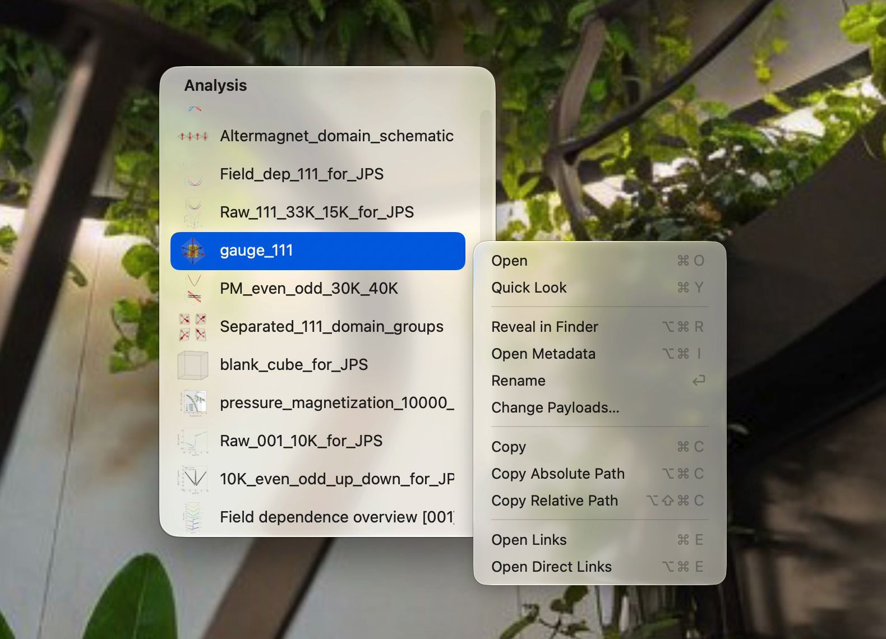
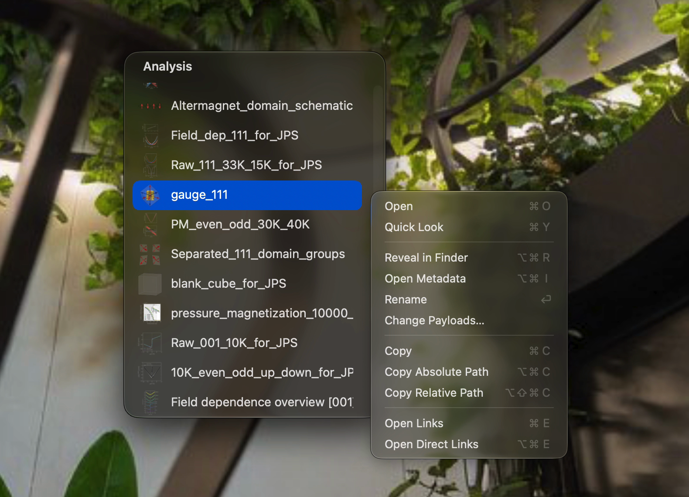

<div align="center">

# Finder Finder

Native application for simple database

[日本語](README_ja.md)

</div>

<p align="center">
  
  
</p>

---

## Database

Put arbitrary folders directly under one Database root.
The folder name is the sole source of truth for its ID, so sequential numbers are recommended. The app automatically assigns an unused six-digit sequential number when adding a record.

Ex)
```text
Database/
└── 000256/
    ├── metadata.json
    ├── measurement.csv
    └── preview.png
```
The app recognizes folders containing `metadata.json`. It reads the following fields.

<details>
<summary>Fields</summary>

| Field | Required | Content |
| --- | --- | --- |
| `category` | ✓ | Lists records by category |
| `display_name` | | Display name only; defaults to the folder name |
| `payload` | For actions | Main file to open in the folder. Uses folder-relative paths; multiple files allowed |
| `preview` | | Display file for Quick Look |
| `links` | | Array of `{"id": "000256"}` objects. Connects related data |

</details>

## Shortcuts

<details>
<summary>Shortcuts</summary>

### Data

| Action | Key | Effect |
| --- | --- | --- |
| Open | `⌘O` / `⌥`+click | Opens payload in the default app |
| Quick Look | `Space` / `⌘Y` / click | Opens the preview file in Quick Look; falls back to payload |
| Reveal in Finder | `⌥⌘R` | Shows it in Finder |
| Open Metadata | `⌥⌘I` | Opens `metadata.json` |
| Rename | `Return` | Changes `display_name` |
| Change Payloads… | right-click menu | Updates `payload` |
| Copy | `⌘C` | Copies payload files |
| Copy Absolute Path | `⌥⌘C` | Copies the absolute path |
| Copy Relative Path | `⌥⇧⌘C` | Copies the path relative to the DB root |
| Open Links | `⌘E` | Lists linked data in both directions, one level each |
| Open Direct Links | `⌥⌘E` | Lists directly linked data |
| Remove Link | `⌘⌫` | Removes a direct link (links window only) |
| Pass payloads | drag a row | Passes payload files to another app (copy) |
| Add record | drop files onto a window | Creates a record with a category and display name |

### Window

| Action | Key | Effect |
| --- | --- | --- |
| Switch category | `⌥`+initial | |
| Sort | | Number (default) / Display name / Last Modified / Most Links |
| Move to screen edge | `⌥⌘↑` `←` `→` `↓` | `↓` centers |
| Always on top | `⌥⌘T` | Keeps the window on top (default ON) |
| Close Window | `⌘W` | Closes only the focused window |
| Clear selection | click the header | |

During Quick Look, arrow keys step through items. Open, Reveal, Copy, and path copying act on the displayed item’s payload.

</details>

## Setup

Requires Rust and Xcode Command Line Tools. Set the DB root for the first build.

```sh
FINDER_FINDER_DB_ROOT=/path/to/Database ./build
```
The app is saved to `/Applications/Finder Finder.app` and launched.
The Database root is saved as `dbRoot` in `~/.finder-finder/settings.json`. Edit it to change databases.

## CLI

A simple CLI for Agents to follow links.

To use it, add `cli/finder-finder` to PATH and place [SKILL.md](cli/finder-finder/SKILL.md) in the Agent’s environment.
