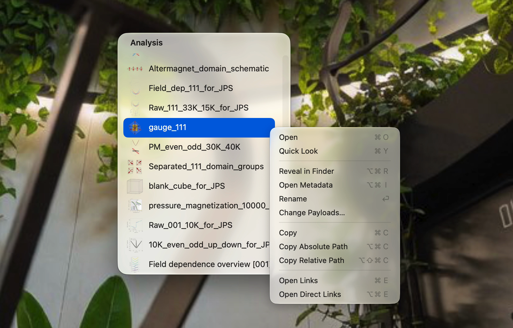

<div align="center">

# Finder Finder

Native application for simple database

[English](README.md)								

</div>

<p align="center">
  
</p>

---

## Database

1つのDatabase root直下に、任意フォルダを雑多に並べる。
フォルダ名がIDの唯一の正本なので、連番が推奨。アプリ操作の規定では未使用の6桁連番が自動で割り当てられる。

Ex)
```text
Database/
└── 000256/
    ├── metadata.json
    ├── measurement.csv
    └── preview.png
```
各フォルダ内に、`metadata.json`を置くと、アプリが認識する。アプリが読む中身は次の通り。

<details>
<summary>field一覧</summary>

| Field | 必須 | 内容 |
| --- | --- | --- |
| `category` | ✓ | カテゴリごとの一覧が表示される 。|
| `display_name` | | 単なる表示名。省略時はフォルダ名が使われる。 |
| `payload` | 操作時 | そのフォルダで開くmain file。フォルダ内の相対pathを使う。複数指定可能。 |
| `preview` | | Quick Look用の表示用file。 |
| `links` | | `{"id": "000256"}` の配列。関連データを繋げる。 |

</details>

## Shortcuts

<details>
<summary>ショートカット一覧</summary>

### Data

| 操作 | キー | 内容 |
| --- | --- | --- |
| Open | `⌘O` / `⌥`+click | payload を既定アプリで開く |
| Quick Look | `Space` / `⌘Y` / click | preview fileをQuick Lookで開く。省略時はpayload。 |
| Reveal in Finder | `⌥⌘R` | Finder で表示 |
| Open Metadata | `⌥⌘I` | `metadata.json` を開く |
| Rename | `Return` | `display_name` を変更 |
| Change Payloads… | right clickから | `payload` を更新する。 |
| Copy | `⌘C` | payload fileをcopy |
| Copy Absolute Path | `⌥⌘C` | 絶対pathをcopy |
| Copy Relative Path | `⌥⇧⌘C` | DB root基準の相対pathをcopy |
| Open Links | `⌘E` | 双方向（各1階層）リンクのデータ一覧を開く |
| Open Direct Links | `⌥⌘E` | 直接リンクしたデータ一覧を開く |
| Remove Link | `⌘`⌫ | 直接リンクを外す（リンク一覧windowのみ） |
| payloadを渡す | 行をdrag | 外部アプリへpayload fileを渡す(copy) |
| Record追加 | windowにfileをdrop | categoryとdisplay nameを指定して作成 |

### Window

| 操作 | キー | 内容 |
| --- | --- | --- |
| Category 切り替え | `⌥`+頭文字 |  |
| Sort |  | Number（既定）/ Display name / Last Modified / Most Links |
| 画面端へ移動 | `⌥⌘↑` `←` `→` `↓` | `↓` は中央 |
| Always on top | `⌥⌘T` | 最前面に固定（既定ON） |
| Close Window | `⌘W` | focusされたwindowだけを閉じる |
| 選択解除 | headerをclick | |

Quick Look中は矢印キーで項目を送る。Open・Reveal・Copy・pathのcopyは表示中の項目のpayloadが対象。

</details>

## Setup

Rust、Xcode Command Line Toolsが必要。初回はDB rootを指定してbuildする。

```sh
FINDER_FINDER_DB_ROOT=/path/to/Database ./build
```
`/Applications/Finder Finder.app` に保存・起動される。
Database rootは `~/.finder-finder/settings.json` の `dbRoot` に保存される。変更時は書き換える。

## CLI

agentがlinkを辿るための簡易CLI

使う場合は `cli/finder-finder` へのPATHと、[SKILL.md](cli/finder-finder/SKILL.md) をAgentの環境に置く。
